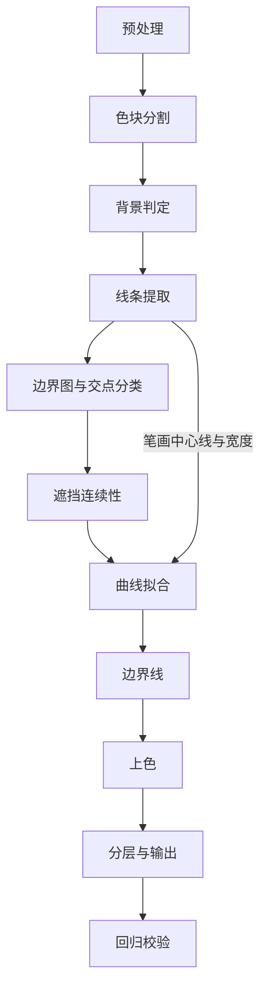

# What's this?

This project converts Grok-bot-like AI-generated avatars into SVG.

目标是输出一份**只由填充路径构成**的 SVG：边界平滑，相邻色块之间没有缝，节点尽量少。只追求还原度和体积，不考虑输出在编辑器里好不好改。背景输出为透明。

照片、纹理、复杂光影不在考虑范围内。

# 样例观察

先看 `example.png` 实际长什么样，再决定算法。下面的数值都是对原图统计得到的：

| 观察项 | 数值 | 对算法的影响 |
| --- | --- | --- |
| 尺寸 | 1254×1254，RGB，无 alpha | 背景要自己判定 |
| 平坦像素占比（5×5 窗口内 L\* 标准差 < 0.8） | 88% | 画面主体是色块 |
| 平坦区内的噪声 | 每通道 σ ≈ 0.5 | 取色用中位数，去噪可选 |
| 不同 RGB 颜色数 | 32862 | 几乎都来自抗锯齿和噪声 |
| 覆盖 80% / 99% 平坦像素所需的 Lab 颜色桶（桶宽 3） | 14 / 57 | 有效调色板只有几十色 |
| 色块边缘的过渡宽度 | 多为 2–4 px，个别 6 px | 边界要做亚像素定位 |
| 线条 | 没有黑色描线；线条是同色系更深的细长色块，宽 2–10 px（中位约 4 px），两端常为尖头 | 线宽必须可变，不能用固定 `stroke-width` |
| 背景色 / 眼睛颜色 | ≈ RGB(36,37,39) / ≈ RGB(35,35,37) | 按颜色抠背景会把眼睛一起抠掉 |
| 大色块内部的颜色跨度（1–99 分位） | 多数 ≤ 3 ΔE，少数 5–6 ΔE；中央刘海一块约 7.6 万 px 的区域沿一个方向渐变约 10 ΔE | 大部分是纯色；渐变输出做成可选项 |

本文的 ΔE 指 CIELAB 空间中的欧氏距离（ΔE76），L\* 取值 0–100。

另外用一个简易分割原型（第 2 节的平坦种子 + 分水岭 + 颜色合并，不含细线种子和小区域合并）在样例上跑了一遍：

- 得到 116 个区域。每个像素直接填所在区域的中位色，ΔE 的 90 分位为 1.8，99 分位为 7.8；
- ΔE > 5 的像素有 59% 落在区域边界 4 px 以内（抗锯齿过渡带），剩下的几乎全在中央刘海那块渐变区里。那块区域改用线性模型拟合后，残差方差下降 71%；
- 三个区域交汇的点共 168 处。能判定方向的交汇点里，T 型 78 个，Y 型 5 个；
- 判定不了的 82 个里，有 67 个紧挨着细线条色块。

由此得到三个结论，它们决定了后面的整体结构：

1. **先分割，后描边。** 边缘检测（滤镜或 CNN）在这类图上会给每条细线产生两条平行边缘，低对比度的边界还会断开。它不产出闭合区域，上色时还得再补一次缝。分割直接给出闭合区域，边界的拓扑天然一致。
2. **线条单独成层**，用「中心线 + 宽度曲线」表达。细线如果当普通色块处理，两侧边界各拟合各的，线宽会抖，尖头会变钝；而且细线周围的交汇点最难判定。
3. **交点以 T 型为主。** T 型交点要求横杠两侧的两条边共用切线，轮廓穿过交点时是否平滑，主要取决于这条约束。

# 总体流程



下文所有像素参数都以 1254 px 为基准，其他尺寸的图按 `max(W, H) / 1254` 线性缩放（8.2 的垫底描边宽度除外）。参数汇总在[参数表](#参数表)。

## 1. 预处理

1. 转到 CIELAB。后面所有颜色距离都在这个空间里算。
2. 去噪默认关闭。样例的噪声只有 σ ≈ 0.5，不影响平坦判定。输入是 JPEG 或噪声明显时，用小半径双边滤波 (bilateral filter)。不要用高斯模糊，它会加宽边缘过渡带。
3. 输入带 alpha 时，alpha = 0 的像素直接归为背景。

## 2. 色块分割

输出一张标签图 (label map)：每个像素属于哪个区域。

**平坦种子。** 3×3 窗口内 L\* 标准差 < 1.0 的像素算平坦像素。相邻平坦像素之间 ΔE < 1.2 就连通，连通块面积 ≥ 12 px 的留作种子。

窗口为什么是 3×3？5×5 窗口下，2–4 px 宽的细线里一个平坦像素都没有，整条线会被旁边的色块吞掉。样例中这样做有 26% 的线条像素被分到了 ΔE > 6 的区域；改成 3×3 后降到 16%。

**细线种子。** 剩下这 16% 是最细的线，需要单独补一路脊线检测 (ridge detection)：

- 对 L\* 做黑帽变换 (black-hat，15 px 圆形核)，响应 > 8 的连通块（≥ 40 px）就是暗细线；
- 亮细线（发卡、高光）用白帽变换 (top-hat)，参数相同；
- 把这些连通块骨架化，每段骨架作为一个额外种子。

**扩张。** 以三通道 Sobel 梯度幅值之和为高度，做带标记分水岭 (marker-based watershed)。过渡带里的像素会归到梯度脊线两侧的种子，分界落在梯度最大处，也就是两色各占一半的位置附近。

**合并。** 在区域邻接图 (Region Adjacency Graph, RAG) 上：

- 相邻区域中位色 ΔE < 2.5 的合并；
- 面积 < 50 px 且不细长（不满足第 3 节的笔画条件）的区域，并入 ΔE 最近的邻居。

**按颜色修正边界像素。** 分水岭只看梯度，不看颜色，偶尔会把一条 1 px 宽的异色像素分给旁边的区域。样例上最典型的情况是：头发外缘有一圈比背景还暗的晕边（L\* 5–10，背景约 15），黑帽变换把它和头发深色描边当成同一条暗线，种子连成一片，结果晕边像素被分进了描边区域（L\* 约 72）。轮廓在 V 形缺口里本该凹进去，画出来却多了一根描边色的尖刺。

合并之后对边界像素再检查一遍：像素离某个 4 邻域区域的颜色比离自己区域近 10 ΔE 以上，而且离那个区域不超过 15 ΔE，就改归那个区域。最多做 3 轮，每轮剥掉一层像素。第二个条件是给抗锯齿像素留的：它们是两种颜色的混合，可能恰好比第三个区域的颜色更近，但并不像它。比如深色与浅色各半的像素离描边色约 22 ΔE，不会被拉进描边区域。

改归之后，区域可能被切出几小块。一个区域只保留最大的 4 连通块；其余小于 50 px 的碎块，并入与它共享边界最长的邻居，否则会画成小斑点。

样例上这一步移动了约 140 个像素。「离邻居颜色近 10 ΔE 以上」的像素从 114 个降到 44 个，剩下的都是上面说的混合像素。

颜色相同但不相邻的两块保持为两个区域，输出时再按颜色合并 path。

种子连通和区域合并都只比较相邻的颜色，会沿着渐变一路传下去。样例中央刘海那块区域在种子阶段就已经连成一片（7.2 万 px，跨度约 10 ΔE）。这正是想要的：渐变区保持为一个区域，由第 7 节决定填纯色还是渐变。

## 3. 线条提取

**判定。** 对每个区域算面积 A、骨架像素数 ℓ、平均宽度 w = A / ℓ。同时满足下面两条的区域判为笔画 (stroke)：

- **细长**：w ≤ 12 px 且 ℓ / w ≥ 4；
- **没有平台**：骨架像素里，落在平坦像素（第 2 节的 3×3 判据）上的比例 < 0.3。

第二条区分「线」和「窄色块」。线的横截面是一道山脊，亮度降到最低马上又回升，中间没有平的一段；发束这类窄色块的横截面中间是一段平的填充色。样例里两类之间有明显的空档：真正的线这个比例是 0–0.2，窄色块是 0.38 以上。

只看细长会把窄色块也当成线，用「中心线 + 宽度」画出来就成了波浪：骨架在色块里游走，距离变换给出的宽度时宽时窄。窄色块留作区域后，两条边各自做亚像素定位和拟合（第 6 节），这样画出来很平滑。这个判据依赖抗锯齿：完全没有抗锯齿的 3 px 线中间一列也是平的，会被当成色块，但 AI 生成的图都有抗锯齿。

样例的 147 个区域里，细长的有 65 个，其中 29 个是线，宽度中位约 3 px。

**细部。** 有的描边和旁边一块同色的色块连在一起，分割时并成了一个区域。样例里发卡的深色描边（宽约 2.6 px）和压在发卡下面的一缕深色头发同色，整圈描边成了那缕头发区域伸出去的细边。作为区域的一部分，描边的宽度就是两条边界各自拟合后的间距。两条边各有 0.6 px 的拟合误差和 σ = 3 px 的平滑，叠在一起，2–3 px 的描边就会一段宽一段窄：样例里发卡下沿有一处，描边从 2.4 px 被拟合成了 1.6 px。

所以判定之前，先对每个不细长的区域做一次开运算（半径 2 px 的圆盘），开运算去掉的部分就是窄于约 5 px 的细部。细部面积 ≥ 50 px、并且本身满足上面两条判据的，单独拿出来当笔画。面积门槛是为了跳过开运算顺带削掉的拐角和阶梯像素。细长的区域整个跳过：它要么本身就是笔画，要么是窄色块，窄色块渐细的末端属于它自己。

紧挨背景的细部也不拆。和后面的边界线一样，前景对透明背景的轮廓保持为区域的边。而且拆掉以后，细部两侧的区域会在笔画下面接上，原来的两条边连成一条重新拟合，误差会摊到整条边上：样例头顶有一处这样的细部，拆开后那条 500 px 长的头发外轮廓整体偏了约 0.4 px。为此背景判定挪到了线条提取之前（第 4 节）。

样例上拆出 5 个细部，其中 4 个是两枚发卡的描边。

每个笔画按下面的步骤处理：

1. **骨架图。** 骨架化，以骨架像素为节点建图。对角相邻的两个像素只有在不共享 4 邻居时才连边，避免阶梯处出现假分叉。度为 1 的像素是端点，度 ≥ 3 的相连像素合成一个分叉簇。
2. **化简。** 先消掉度为 2 的节点，再反复执行：剪掉长度 < 1.5w 的毛刺 (spur)；两个分叉簇之间的分支短于 w 时合成一个簇。两条细线交叉时，骨架会裂成两个相距很近的三叉点，这一步把它们并回一个。

   有一种毛刺不剪：它沿着同一分叉簇的另一条分支笔直延续，按第 3 步的方法能和那条分支配成对。这是被分割截短的线头，不是骨架在角上分出的叉。剪掉它，线会在分叉处拐进旁边的分支，画出一个方向不对的钩。样例里衣领上方有一根线就是这样：线头只剩 1 px 骨架，旁边是一条 10 px 长的淡色分支，原先画出来的线在线头处拐了个直角。
3. **串成笔画链。** 在每个分叉簇按 5.2、5.3 的方法估计各分支方向（r0 = max(3 px, w)），夹角 < 25° 的两条分支配对。从端点出发沿骨架走，只经配对分支穿过分叉簇；每条分支只走一次，最后剩下的闭环从任意点出发。这样一条穿过交叉点的线是一整条平滑曲线，而不是四段。
4. **平滑中心线。** 链按 1 px 重采样后做 σ = 4 px 的高斯平滑。开链两端先按端点做点对称延拓再滤波，所以端点位置和端点方向都不变。骨架有 ±0.5 px 的阶梯，而且会在线里来回游走，不平滑的话拟合会跟着走出波浪。样例上，这一步让中心线拐点从每 100 px 5.2 个降到 2.4 个。
5. **宽度和位置。** 宽度按线在原图里的「墨量」算。沿法向取横截面，一个像素的墨量是它的颜色从旁边色块往线色移动了多少，取值 0–1；把整个横截面的墨量加起来，就是用线色画出同样多的墨需要多宽。淡下去的一段墨少，画出来就细。

   横截面在山脊（墨量最大处）分成两半，每一半对照自己那一侧的颜色，所以落在两个色块分界上的线也能量。两半各自的宽度还给出线的中心：骨架在笔画区域正中，可区域边界是分水岭定的，可能偏离线的墨迹零点几个像素，中心线按两半的差挪过去。

   墨量是相对线色算的，所以输出必须用同一个颜色。线色取骨架像素的中位数，也就是线心的颜色，不含抗锯齿边。某一侧和线色的 ΔE < 4 时（交叉处、紧挨着同色的色块）墨量没有意义，宽度退回 2 × 距离变换值，中心不挪。分叉簇附近的区域比任何一条线都宽，这一段的宽度和中心偏移都用两侧插值。

   横截面里如果混进了另一个更深的东西，比如描边外侧不远就是背景，它的像素投影到「侧边色 → 线色」方向上会远超 1，截断成 1 以后就被算成了线的墨，线因此变宽。所以离侧边色和线色之间的混色太远的样本不算墨，容差是两者色差的一半，至少 4 ΔE。

   最后宽度和偏移都用 σ = 2w 平滑。窗口太短会一鼓一瘪：距离变换是量化的，3 px 左右的线会在 2 px 和 4 px 之间跳；墨量是连续的，但带着原图线条本身的粗细起伏。对距离变换宽度，σ = 2w 让鼓包（起伏 ≥ 0.3 px 的局部极值）从每 100 px 4.1 个降到 1.6 个。尖头在平滑之后才补上，不受影响。

   在样例上，墨量宽度和 2 × 距离变换的中位比值是 1.05，整体没有变粗或变细，差别在局部：淡的一段画细了，被区域带偏的线挪回了墨迹上。偏移量的中位数是 0.04 px，90 分位 0.19 px。和距离变换相比：

   - 笔画 3 px 以内 ΔE 的均值从 3.72 降到 3.27，95 分位从 10.7 降到 8.8，99 分位从 32.5 降到 25.5；
   - 平滑后的鼓包从每 100 px 1.56 个降到 1.26 个；
   - 中心线拐点从每 100 px 3.2 个增加到 3.6 个。这是在现在的 29 个笔画上重新统计的（曲率越过 ±1/150 px⁻¹ 才算一次变号），和第 4 步的数字不是同一批线。偏移量只有零点几个像素，看不出波浪。
6. **端点分类。** 每个自由端（骨架端点，不是分叉簇）分成两种：
   - **截断端**：靠近端点的宽度（距端点 0.5w–2w 的中位数）不低于整条链中位数的 60%，而且端点外紧挨着的区域不是线两侧的区域。先沿端点方向探 6 px；探到的是线两侧的区域时，改看端点 w 范围内接触最多的第三个区域（至少 3 px）。短链的端点方向常被分叉簇带偏，靠后者兜底。还要求遮挡物的轮廓与线足够陡地相交，夹角正弦 ≥ 0.7（约 45°）；更平的话，线其实是贴着那条轮廓走，并没有被挡住。截断端说明线被前面的东西挡住了，见 5.5；
   - **自然端**：其余情况。分割常把线头淡下去的那一截分给周围的色块，笔画区域提前结束，画出来像被剪断了；线中间淡的一段也会这样被切走，一根线变成两截。所以自然端先沿原图里的山脊往外追。从端点往回退 w 起步，因为骨架末端常弯向区域的一个角。每走 0.5 px，在法向 ±1 px 内找墨量最大的位置，新方向七成沿用旧方向、三成跟随山脊，这样不会被单个像素的噪声带偏。追到下面任一情况为止：
     - 山脊处的墨量低于 0.3：线淡没了，宽度在最后 w 内收成尖头；
     - 山脊上的像素既不属于这个笔画，也不属于两侧的色块，说明撞上了另一个笔画或色块：用圆头结束。断成两截的线就这样接上；
     - 某一侧的颜色和线色 ΔE < 4：线贴上了同色的东西，也用圆头结束。

     延长段的宽度就是一路量到的墨量，平滑方式同第 5 步。如果追了 64 px 山脊还没结束、追出了图像，或者连原来的端点都没越过，说明这不是一个淡出的线头，改用区域来补：沿端点切线向外走到离开区域，走出的距离 > 0.75 × 端点宽度时是尖头，宽度在延长段上线性降到 0；否则是圆头。

     样例的 57 个自然端里，37 个追踪成功，其中 25 个淡出成尖头，最长的延长 51 px。

   分叉簇处的链端点一律用圆头，它们被交叉的另一条线盖住。
7. **截断端处理。** 中心线延长到线和遮挡物的交界点；端点 w 以内的宽度固定为截断宽度，到 2w 处过渡回实测宽度。轮廓在交界点沿遮挡物轮廓的方向（附近遮挡物边界像素的主方向）平切，不加尖头或圆头。

   斜着切一条宽为 w 的线，切口一侧会越过中心线端点 (w/2)·cot θ，θ 是切线与线的夹角。θ 很小时，平切就变成一根长尖刺。样例上原先有 8 个截断端的 sin θ 在 0.27–0.66 之间，其中一处在线头上多出 3.6 px 的尖。第 6 步的 0.7 门槛把这类端点改判成自然端；拟合后的中心线方向若和判定时略有偏差，生成轮廓时同样用 0.7 兜底，退回垂直切。现在越过端点的部分最多约 w/2。
8. **中心线拟合。** 见第 6 节，ε = 0.4 px。
9. **生成轮廓。** 沿拟合后的中心线每 0.5 px 采样，向两侧法向各偏移 w(s)/2，加上圆头、尖头或平切，再对这个闭合轮廓拟合一次贝塞尔曲线（ε = 0.4 px）。偏移曲线不是贝塞尔曲线，只能重新拟合。同一笔画的多条链用 nonzero 规则填充，重叠处自然合并。
10. **底图补洞。** 每个笔画像素改成离它最近的非笔画像素的标签，两侧色块在笔画中线处相接。这样底图里没有窄缝，笔画画在上层。细部拆出来的笔画也一样，原来的区域在笔画下面和邻居相接。

### 边界线

还有一种描边连区域都没分到。它和一侧的对比度很低，没有种子，分水岭把它的像素分给两侧的色块，边界正好从线中间穿过，线就没了。上面那枚发卡左端就是这样：描边 L\* 约 74，旁边那缕头发 L\* 约 82，只差 8 ΔE，黑帽响应 8–10，在阈值附近断断续续，整段描边被两边分掉，白色直接贴着头发。

这一步在曲线拟合（第 6 节）之后做，沿每条两侧都是前景的边找：

1. **找墨。** 沿拟合后的边每 1 px 取一个横截面，范围是两侧各 3 px。抗锯齿只能产生两侧颜色在 sRGB 里的混色，所以拿每个像素的颜色和这条混色曲线比，离曲线 ≥ 5 ΔE 的就是第三种颜色的墨。混色曲线在 Lab 里是弯的，红绿之间最多偏离直线 28 ΔE，不能用 Lab 直线段代替。取样用像素本身的颜色，不插值：在 Lab 里插值，硬边两侧之间会插出 Lab 直线段上的颜色，正好落在混色曲线外面。
2. **排除别人的抗锯齿。** 墨点 2 px 以内有第三个区域的不算，那是第三个区域自己的抗锯齿；离已有笔画 3 px 以内的也不算。
3. **成线。** 连续的墨点（允许 2 px 空档）至少 12 px 长才算一条线，线色取墨点颜色的中位数。线色和较近一侧的差还要至少是两侧色差的 0.2 倍。眼睛外圈有一道比眼珠还暗的细边，只比眼珠暗 6 ΔE，可眼白和眼珠差 85 ΔE。这么淡的边落在这么陡的边界上，本来就在边界的抗锯齿范围里，画出来挪动陡边的代价和它带来的改善相当：样例上这样的 11 条，一半变好一半变差。
4. **量宽度。** 按第 5 步量墨，侧边色取线外侧那一点的颜色，渐变区域就按它在边附近的颜色比较。那一点要是落进了第三个区域（比如另一侧是条窄色块），改用这条边上那个区域的中位色。超过一半的横截面量不出墨（和一侧的色差 < 4 ΔE）的整条丢掉；个别量不出的地方宽度记为 0，线在那里淡出。
5. **线头。** 离边的端点不到 4 px 的线头延长到端点，用圆头：线通常会接着沿下一条边走，或者走进一块和它同色的区域，端点附近的样本只是被第 2 步的间距条件去掉了。其余线头在最后 w 内收成尖头。

边界线画在笔画层，和笔画一样按颜色合并。样例上找出 36 条。

发卡的描边现在由三部分组成：自己成区域的部分本来就是笔画，并进头发的部分作为细部拆出来，被分掉的部分由边界线补上。沿上面那枚发卡的轮廓量描边宽度，原来有 41 个采样点的宽度不到原图的 3/4，现在只剩 2 个；宽度的平均偏差从 0.40 px 降到 0.27 px。描边整体比原图宽约 0.15 px。

## 4. 背景判定

这一步在线条提取之前做，因为拆细部（第 3 节）要知道哪些区域会变透明。前两步只标出背景区域；等线条提取完、笔画像素改给相邻区域以后，再做第 3 步。

1. 取图像四条边上的所有像素，按 ΔE 2.5 聚类，最大簇的中位色记为 c_bg。
2. 背景 = **与图像边框连通**、且中位色与 c_bg 的 ΔE < 3 的区域集合。

注意只能沿连通性找，不能全局按颜色匹配。样例的眼睛和背景只差约 1 ΔE，但眼睛被脸包住，不与边框连通，这样才能保住。

3. 所有背景区域合并为同一个标签，**不输出**，画布上对应的位置保持透明。前景与背景之间的边界就是前景区域的外轮廓。
4. 记下 c_bg，第 9 节校验时把 SVG 叠到 c_bg 上再和原图比较。

背景选透明，是因为给透明 SVG 垫一块纯色很容易，反过来从 SVG 里去掉背景却要重新处理边缘。

## 5. 边界图与交点分类

### 5.1 建图

在标签图的像素网格上建平面图 (planar map)：

- **边界**：两侧标签不同的像素分隔边 (crack edge)；
- **节点**：2×2 像素块内出现 ≥ 3 个不同标签的格点，以及边界与图像边框的交点。相距 ≤ 2 px 的节点合为一个簇，取质心；
- **边**：两个节点之间的一串分隔边。每条边恰好被左右两个区域共享。没有节点的闭合边界（腮红、眼睛）是一条首尾相接的环。

节点合并后，两端落在同一个簇、长度不超过 2 × 簇半径 + 2 px 的边直接删掉，它们只是簇内部的碎边。删掉后各区域的边界环仍然首尾相接，因为这些边的两端都吸到了同一个簇心。

这里有一条硬约束：**每条边只拟合一次**，两侧区域引用同一条曲线，一个正向、一个反向。这样几何上就不存在缝隙和重叠。逐色描边的做法（例如对每种颜色分别跑 potrace）做不到这一点，相邻色块之间一定会有缝或重叠。

### 5.2 切线估计

交点周围 2–3 px 内的像素被抗锯齿和阶梯走样污染，方向不可信，所以要离开交点一段再看。

对每条入射边，取弧长在 [r0, r0 + 8 px] 范围内的点，用主成分分析 (PCA) 拟合直线，得到这条边离开节点的单位方向 d_i。r0 = max(3 px, 局部线宽)。边太短时用全部可用点。

### 5.3 分类

对节点的每一对入射边 (i, j)，**连续性代价** = d_i 与 −d_j 的夹角。代价为 0° 表示 i、j 能连成一条笔直穿过节点的线。

| 节点度 | 判定 | 类型 | 拟合约束 |
| --- | --- | --- | --- |
| 1 | 笔画骨架的端点 | 端点：线条的起点或终点 | 按第 3 节补全笔尖 |
| 3 | 代价最小的一对 < 25° | T 型：一条线的终点撞到另一条线上 | i、j 共用切线（G1 连续），第三条边独立 |
| 3 | 否则 | Y 型：三条线交于一点，互不延续 | 三条边各用各的切线，节点是尖角 |
| 4 | 三种两两配对中总代价最小的那种，两对都 < 25° | X 型：两条线交叉穿过 | 每一对共用切线 |
| 4 | 否则 | 拆成 T 或 Y | 代价 < 25° 的那一对共用切线，其余独立 |

初稿列出的三种交点分别对应 X 型、T 型和端点。补充的 Y 型在色块边界上常见（三个色块交于一点，谁也不延续）。样例的区域边界图里没有出现度为 4 的节点，X 型主要出现在笔画骨架上。

### 5.4 边内部的拐角

拐角不在节点上，但和交点一样是曲线必须经过、而且切线在此断开的点。

沿每条边按弧长每 1 px 重采样。在点 p 处取前后各 4 px 的点，算转角 φ(p)。φ 是局部极大值且 > 60° 的点为拐角，边在这里切开。发丝的尖端就是典型拐角。

### 5.5 遮挡连续性

一条轮廓被前面的东西（发卡、高光条）挡住时，图上只剩遮挡物两边各一段。分别拟合的话，两段各歪各的，看起来接不上。这一步把它们认成同一条曲线的两段。只调整可见部分的几何，被挡住的部分不输出。

这里的「轮廓」既包括色块之间的分界，也包括第 3 节的笔画。发卡那里同一根发束边，上方是一条深色边线，下方只剩两个色块的分界，两种都要能接上。

**遮挡端。** 一段轮廓停在前景物体 F 开始的地方，叫遮挡端。候选来自两处：

- 节点处的边端，前提是它没有和别的边 G1 配对（不是 T 的横杠）；
- 边内部的拐角：轮廓碰到 F 的描边后拐了弯，沿描边走了。这类拐角往往只拐 50° 左右，所以候选拐角用 35° 的阈值，比拟合用的 60° 低。没配上对的候选不会切开曲线。

F 的判定：从端点沿轮廓的延长方向探 6 px，第一个不属于轮廓两侧的标签。这样能越过 2–4 px 宽的描边。背景不算 F。

**配对条件**，全部满足后按代价贪心配对：

1. 两端的 F 相同，间距 ≤ 64 px；
2. 两端朝向对方，各自方向与连线的夹角 ≤ 30°；
3. 连线至少 70% 落在 F 内。两端各 6 px 不计，那里常是 F 的描边，和探测 F 时的放宽一致；
4. 两侧颜色对应：两侧 ΔE 都 < 6，或者一侧是同一个区域、另一侧 ΔE < 18；
5. 两段可见部分（各取端点 16 px 以内）能用一条二次曲线拟合，残差 RMS ≤ 0.5 px。这一条排除了两条平行但错开的轮廓，二次曲线拟合不了 S 形。

笔画的截断端用同一套配对，只是第 4 条换成笔画颜色 ΔE < 6、宽度比在 0.6–1.67 之间。

**配上对之后：**

- 端点沿 F 的轮廓方向滑到联合曲线上，最多 1.5 px；
- 端点 11 px（r0 + 8 px）以内的点向联合曲线拉近，端点处完全拉上，往里线性减弱。遮挡物边上的抗锯齿和描边会把轮廓末端掰弯，这和 5.2 跳过前 r0 的理由相同；
- 端点切线取联合曲线的切线。节点端直接覆盖 5.3 的结果，拐角端作为强制切分点交给第 6 节。

样例上配出 7 对：4 对是发卡两根横条左右两端挡住的发束边，2 对是白色高光条两边的发丝，1 对在别处。下表是发卡 4 对加入这一步时测的结果。拐折角是每段末端 3 px 的方向与两段联合二次曲线切线的夹角（两段取较大者），RMS 是两段拟合结果到这条二次曲线的残差：

| 位置 | 改前 拐折角 / RMS | 改后 拐折角 / RMS |
| --- | --- | --- |
| 下横条右端 | 0.3° / 0.03 px | 0.5° / 0.01 px |
| 下横条左端 | 28.5° / 0.60 px | 4.3° / 0.18 px |
| 上横条左端 | 12.3° / 0.29 px | 4.5° / 0.32 px |
| 上横条右端 | 13.8° / 0.44 px | 1.3° / 0.06 px |

白色高光条两边的发丝最初没有配上对：高光条下方那段是一条窄发束，被当成线画了，端点方向偏了 36°，宽度只有上方那段的 0.4 倍。第 3 节加了平台判据之后，它作为区域参与配对，联合拟合残差 0.13 px。

## 6. 曲线拟合

区域边界和笔画中心线用同一套流程，只是误差阈值不同。

### 6.1 亚像素定位

分隔边上的点落在像素边界上，呈阶梯状。拟合前先把每个点沿法向挪到真实边缘：

1. 沿法向在 ±3 px 内采样原图颜色 c(t)，两侧区域色为 c_L、c_R；
2. 混合比例 α(t) = ⟨c(t) − c_R, c_L − c_R⟩ / |c_L − c_R|²；
3. 边缘位置取 α = 0.5 处的 t。

以下情况 α 不可信，改为对点列做高斯平滑（σ = 1 px，两端固定）：两侧颜色太接近（c_L、c_R 的 ΔE < 5）；点在节点 2 px 以内；点紧挨着笔画像素（第 3 节第 10 步改过标签的地方，图上是笔画的颜色，不是两侧的混合）；算出的位移超过 1.5 px。

### 6.2 分段

固定点 = 节点 + 拐角 + 5.5 配上对的拐角端。拐角端是强制切分点：位置保持不变，两侧切线可以单独指定。相邻两个固定点之间的点列为一段，单独拟合。

**拟合前平滑。** 每一段先做高斯平滑：区域边界 σ = 3 px，笔画中心线 σ = 4 px（见第 3 节）。和中心线一样，开段两端按端点做点对称延拓再滤波，端点不动；闭合且没有拐角的环用循环边界。拐角和强制切分点是段的端点，不会被磨圆。

为什么需要这一步：亚像素定位后的边界本身已经很干净，按 ±10 px 窗口的局部三次拟合算，残差 90 分位只有 0.07 px，超过 0.8 px 的 30 处全在真正的拐角上。但原图的边界带着波长 20–60 px 的缓慢起伏，幅度比 ε = 0.6 px 大，Schneider 拟合会老老实实地跟着走，看起来就是波浪。拟合误差 ε 管不了这种起伏，只能先平滑。

用「拐点数 / 100 px」衡量波浪（曲率要越过 ±1/150 px⁻¹ 才算一次变号）。区域边界上的结果：

| 区域边界平滑 σ | 拐点 / 100 px | ΔE 均值 | 边缘偏差 | 贝塞尔段数 |
| --- | --- | --- | --- | --- |
| 0 | 2.36 | 1.075 | 0.31 px | 3353 |
| 1.5 px | 1.77 | 1.082 | 0.31 px | 2900 |
| 2.5 px | 1.50 | 1.087 | 0.31 px | 2701 |
| 4 px | 1.26 | 1.095 | 0.32 px | 2491 |

取 3 px：再往上拐点减少得不多，色差开始明显上升。高斯平滑会让弯曲处稍微往里收，偏移约 σ²/(2R)。半径 30 px 的弯处约 0.15 px；更尖的地方都是拐角，不参与平滑。

### 6.3 Schneider 拟合

用 Schneider 的三次贝塞尔拟合算法（*An Algorithm for Automatically Fitting Digitized Curves*，Graphics Gems，1990）：

1. 按弦长参数化；
2. 两端切线已知，最小二乘求两个控制柄的长度，得到一条三次贝塞尔曲线。解出的长度为负、或者比点列的弧长还长时，改用弦长的 1/3：病态解会让曲线在采样点之间甩出很远。点列不超过 3 个点时直接用直线段；
3. 算点列到曲线的最大距离 e：
   - e ≤ ε：完成；
   - e ≤ 16ε：用 Newton–Raphson 重新参数化，回到第 2 步，最多 8 次；
   - 否则在误差最大的点切开，两半递归。切点处的切线取两侧点的中心差分方向，保证 G1 连续。

Schneider 原文用的是 4ε、4 次。样例上 16ε、8 次的贝塞尔段数少 5%（3685 → 3492），色差不变，拟合时间约翻倍。

两端切线从哪里来：

- T 型和 X 型中配对的边：共用切线；
- 5.5 配上对的遮挡端：联合曲线的切线；
- Y 型、拐角、其余端点：用 5.2 的 PCA 方向；
- 递归产生的切点：中心差分。

区域边界的 ε 默认 0.6 px，笔画中心线和笔画轮廓的 ε 默认 0.4 px，因为线条比色块边缘更显眼。

### 6.4 化简

拟合完成后，从头到尾尝试合并相邻两段：两段交界处是 G1 连续时，把两段的点列合起来重拟合一条曲线，误差 ≤ ε 就合并。

## 7. 上色

**取样。** 区域掩码先腐蚀 2 px，去掉抗锯齿过渡带。腐蚀后不足 20 px 的（很窄的色块），改用骨架上的像素。笔画不在这里取色，用第 3 节第 5 步量墨量时的线色。

**取色。** 取 CIELAB 中位数，再转回 sRGB 十六进制。用中位数而不用平均值：腐蚀后仍可能残留混色像素，平均值会被它们拉向邻居的颜色。

**渐变（可选，默认关闭）。** 关闭时每个区域都填中位色。样例中央刘海那块渐变区填纯色时，区域内部 ΔE 的 90 分位是 7.1；填线性渐变时是 2.8。

开启后，对取样像素逐通道做最小二乘拟合：c(x, y) = c0 + g_x·x + g_y·y。设区域沿梯度方向的投影长度为 D，预测跨度 Δ = |g|·D（三通道合成为 ΔE）。同时满足下面两条时，输出 `<linearGradient gradientUnits="userSpaceOnUse">`，两个 stop 放在区域沿梯度方向投影的两端：

- Δ > 4 ΔE；
- 拟合后残差方差比纯色模型下降 ≥ 50%。

否则仍填纯色。4 ΔE 这个阈值来自样例：大色块的颜色跨度多数 ≤ 3（噪声），少数 5–6（轻微渐变）。

**统一颜色。** 输出前把 ΔE < 1 的颜色归成同一个值。这种差异肉眼分不出，统一后同色区域可以合并成一条 path（见 8.3），文件更小。

## 8. 分层与输出

### 8.1 图层

从下到上三层：

1. 垫底描边层（见 8.2）；
2. 填充层：所有底图区域。区域之间严格拼接、互不重叠，层内顺序不影响形状，按颜色分组输出；
3. 笔画层。

背景不输出。

### 8.2 接缝

即使两块区域共用同一条边，渲染器也会分别对它们做抗锯齿。边上的像素被两块各盖住一半，两次半透明叠加后会透出下面的东西，形成一条发丝缝 (conflation artifact)。

处理方法是在填充层下面垫一层描边：

- 两侧都是前景区域的边，每条只描一次，`stroke-width="2"`，`stroke-linecap="butt"`；
- 描边颜色取这条边两侧区域中，在填充层里**先画**的那一个的颜色；
- 与背景相邻的边、与图像边框重合的边不描，让前景外轮廓对透明背景正常抗锯齿；
- 整个垫底层用前景区域的并集做 `clipPath`。否则描边在节点处会从前景外轮廓探出去，在透明背景上留下小毛刺。

宽度用 2 px 而不是 1 px，是 resvg 实测的结果：红绿两块共用一条斜向曲线边、底色为黑时，不垫底的边缘像素最多漏出约 25% 的底色；垫 1 px 描边还漏约 7%（边斜穿像素时 1 px 盖不满）；1.5 px 漏约 1.5%；2 px 不再漏。描边多出来的宽度压在后画区域的完整覆盖区里，看不见。这个宽度的单位是输出像素，不随图像尺寸缩放：缝来自渲染时的抗锯齿，和画面内容的尺度无关。

为什么取先画那一侧的颜色：设边上某个像素被 A、B 各盖一半，A 先画，垫底描边以颜色 S 盖满这个像素，最终颜色是 0.5B + 0.25A + 0.25S。S = A 时正好得到 0.5A + 0.5B，和按面积混合的结果一致；S = B 时会偏向 B，相当于边界挪了约 0.25 px。

和「每个区域整圈加同色描边」相比，这样做边界不会偏移 0.5 px，前景外轮廓也不会被描边撑大。

### 8.3 路径

- 区域轮廓 = 外轮廓 + 洞（洞的方向相反），`fill-rule="evenodd"`；
- 同色区域合并成一条 path（填充层内顺序无关，见 8.1），同色的垫底描边也合并成一条；
- 坐标保留 1 位小数，用相对命令；
- 根元素 `viewBox="0 0 W H"`。

## 9. 回归校验

把输出的 SVG 用 resvg 栅格化回原尺寸，叠到背景色 c_bg 上，再和原图比较三组指标：

- **色差**：逐像素 ΔE 的均值、95 分位、99 分位；
- **边缘偏差**：原图标签边界与栅格化结果边界之间的平均距离 (chamfer distance)；
- **体积**：path 数、贝塞尔段数、文件字节数。

调 ε、合并阈值、拐角阈值时以这三组数为准。作为参照，分割结果本身（每个像素直接填区域中位色）的 ΔE 90 分位是 1.8，99 分位是 7.8，SVG 应该落在同一量级。区域边界附近的 ΔE 如果明显高于这个参照，先查 8.2 的接缝处理。

当前实现在样例上的结果（`grok-avatar2svg example.png --validate`）：

| 指标 | 默认（纯色） | `--gradients` |
| --- | --- | --- |
| ΔE 均值 | 1.08 | 0.99 |
| ΔE 95 分位 | 3.22 | 2.49 |
| ΔE 99 分位 | 7.43 | 5.44 |
| 边缘偏差 | 0.32 px | 0.30 px |
| path 数 | 154 | 162 |
| 贝塞尔段数 | 2787 | 2787 |
| 文件大小 | 82 KB | 84 KB |

整个流程约 7–9 s。

# 参数表

像素参数以 1254 px 为基准。

| 参数 | 默认值 | 阶段 | 依据 |
| --- | --- | --- | --- |
| 平坦窗口 / L\* 标准差阈值 | 3×3 / 1.0 | 2 | 5×5 会丢细线 |
| 种子连通 ΔE | 1.2 | 2 | 噪声 σ ≈ 0.5 |
| 最小种子面积 | 12 px | 2 | |
| 黑帽 / 白帽核 · 响应阈值 · 最小面积 | 15 px · 8 · 40 px | 2 | 线宽 2–10 px |
| 区域合并 ΔE | 2.5 | 2 | |
| 小区域面积 | 50 px | 2 | 也是碎块并入的上限 |
| 边界像素改归：比自身近 · 与目标相差 | 10 ΔE · 15 ΔE | 2 | 混合像素离第三色约 22 ΔE |
| 笔画判定 | w ≤ 12 px 且 ℓ/w ≥ 4，骨架平台比例 < 0.3 | 3 | 线 0–0.2，窄色块 ≥ 0.38 |
| 细部：开运算半径 · 最小面积 | 2 px · 50 px | 3 | 窄于约 5 px；跳过细长区域和紧挨背景的细部 |
| 毛刺长度 | 1.5w，笔直延续另一分支的不剪 | 3 | 被截短的线头 |
| 中心线平滑 σ | 4 px | 3 | 拐点 5.2 → 2.4 / 100 px |
| 笔画宽度 · 平滑 σ | 墨量（某一侧与线色 ΔE < 4 时用 2 × 距离变换）· 2w | 3 | 样例实测，见第 3 节第 5 步 |
| 墨量：混色容差 | 侧边色与线色之差的 0.5 倍，至少 4 ΔE | 3 | 挡住线外侧更深的物体 |
| 截断端：宽度比 · 接触像素 · 最小夹角正弦 | 0.6 · 3 px · 0.7 | 3 | 平切越过端点 (w/2)·cot θ |
| 线头追踪：墨量下限 · 最长 | 0.3 · 64 px | 3 | 样例里最长的延长 51 px |
| 边界线：离混色曲线 · 搜索范围 · 最短 | 5 ΔE · 两侧各 3 px · 12 px | 3 | 混色按 sRGB 算 |
| 边界线：离第三区域 · 对比度比 · 线头延长 | 2 px · 0.2 · 4 px | 3 | 对比度比挡掉眼睛外圈的淡边 |
| 背景 ΔE | 3 | 4 | |
| 节点簇半径 | 2 px | 5 | |
| 切线采样区间 | [max(3 px, w), +8 px] | 5 | 过渡带 2–4 px |
| T / X 配对角度 | 25° | 5 | |
| 拐角转角 · 窗口 | 60° · ±4 px | 5 | |
| 遮挡：最大间距 · 方向夹角 · 落在 F 内的比例 | 64 px · 30° · 70% | 5.5 | |
| 遮挡：两侧 ΔE · 联合拟合 RMS | 6 · 0.5 px | 5.5 | 样例上正确的对 ≤ 0.42 px，错误的 ≥ 0.70 px |
| 遮挡：候选拐角 · 探测距离 · 端点滑动 · 拉近范围 | 35° · 6 px · 1.5 px · 11 px | 5.5 | |
| 拟合误差 ε | 色块 0.6 px，笔画 0.4 px | 6 | |
| Newton 重参数化 | e ≤ 16ε，最多 8 次 | 6 | 比 4ε 少 5% 段数 |
| 区域边界平滑 σ | 3 px | 6 | 见 6.2 的表 |
| 腐蚀半径 | 2 px | 7 | 过渡带 2–4 px |
| 渐变阈值（仅开启渐变时） | Δ > 4 ΔE 且残差下降 ≥ 50% | 7 | 色块跨度 ≤ 3 / 5–6 |
| 垫底描边宽度 | 2 px，不缩放 | 8 | resvg 实测，1 px 仍漏底色 |

# 设计决策

| 决策 | 选择 | 理由 |
| --- | --- | --- |
| 可编辑性 | 不考虑 | 只追求还原度和体积 |
| 笔画表示 | 可变宽填充轮廓 | 能还原尖头，固定宽 `stroke` 做不到 |
| 接缝处理 | 垫底描边（8.2） | 不需要推断遮挡关系；遮挡补全的主要收益是可编辑，已经用不上 |
| 被遮挡的线 | 只对齐可见部分，不输出被挡住的部分 | 不考虑可编辑性；画出被挡部分还需要额外的图层顺序 |
| 渐变 | 可选，默认关闭 | 默认全部填纯色 |
| 背景 | 透明 | 给透明 SVG 垫纯色很容易，反过来要重新处理边缘 |
| 拟合误差 ε | 色块边界 0.6 px，笔画 0.4 px | 亚像素级，比 2–4 px 的抗锯齿过渡带小得多 |

# 使用

```bash
grok-avatar2svg example.png -o out/example.svg             # 输出 SVG
grok-avatar2svg example.png -o out/example.svg --validate  # 同时打印第 9 节的指标，需要 resvg-py
grok-avatar2svg example.png --gradients                    # 开启渐变
python -m unittest discover -s tests                            # 单元测试
```

依赖：numpy、opencv-python、pillow、scikit-image、scipy；校验需要 resvg-py。
