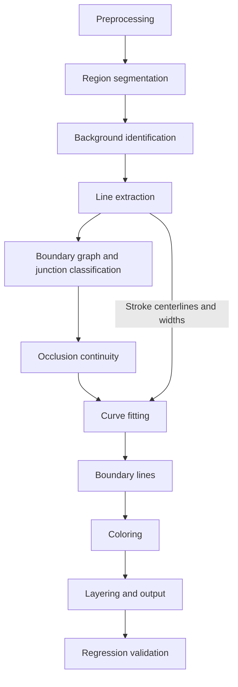

**[English](design.md)** | [简体中文](design.zh-CN.md)

# What's this?

This project converts Grok-bot-like AI-generated avatars into SVG.

The goal is an SVG **made entirely of filled paths**: smooth boundaries, no gaps between adjacent color regions, and as few nodes as possible. Fidelity and file size are the only priorities; ease of editing the output in an editor is not a consideration. The background is transparent.

Photos, textures, and complex lighting are out of scope.

# Sample observations

First, examine what `example.png` actually looks like, then choose the algorithm. All figures below were measured from the original image:

| Observation | Value | Implication for the algorithm |
| --- | --- | --- |
| Dimensions | 1254×1254, RGB, no alpha | The background must be identified explicitly |
| Flat-pixel proportion (L\* standard deviation < 0.8 in a 5×5 window) | 88% | Most of the image consists of color regions |
| Noise in flat areas | σ ≈ 0.5 per channel | Use the median for color sampling; denoising is optional |
| Number of distinct RGB colors | 32862 | Almost all come from antialiasing and noise |
| Lab color bins needed to cover 80% / 99% of flat pixels (bin width 3) | 14 / 57 | The effective palette contains only a few dozen colors |
| Transition width at region edges | Mostly 2–4 px, occasionally 6 px | Boundaries need subpixel localization |
| Lines | No black outlines; lines are darker, elongated regions in the same color family, 2–10 px wide (median about 4 px), often with pointed ends | Width must vary; a fixed `stroke-width` will not work |
| Background color / eye color | ≈ RGB(36,37,39) / ≈ RGB(35,35,37) | Removing the background by color would also remove the eyes |
| Color range inside large regions (1st–99th percentile) | Mostly ≤ 3 ΔE, occasionally 5–6 ΔE; a region of about 76,000 px in the central bangs varies by about 10 ΔE along one direction | Most regions are solid colors; gradient output should be optional |

Throughout this document, ΔE means Euclidean distance in CIELAB space (ΔE76), with L\* in the range 0–100.

A simple segmentation prototype was also run on the sample (the flat seeds + watershed + color merging from section 2, without thin-line seeds or small-region merging):

- It produced 116 regions. Filling each pixel directly with its region's median color gave a 90th-percentile ΔE of 1.8 and a 99th-percentile ΔE of 7.8;
- Of pixels with ΔE > 5, 59% were within 4 px of a region boundary (the antialiasing transition band). Almost all the rest were in the gradient region in the central bangs. Fitting that region with a linear model reduced residual variance by 71%;
- There were 168 points where three regions met. Among junctions whose directions could be determined, 78 were T-junctions and 5 were Y-junctions;
- Of the 82 junctions that could not be classified, 67 were immediately adjacent to thin-line regions.

These observations lead to three conclusions that determine the overall structure below:

1. **Segment first, then trace boundaries.** Edge detection (filters or CNNs) produces two parallel edges for every thin line in this kind of image, and low-contrast boundaries can break apart. It does not produce closed regions, so gaps still need to be repaired before coloring. Segmentation gives closed regions directly, with inherently consistent boundary topology.
2. **Put lines on a separate layer**, represented as a centerline plus a width profile. Treating thin lines as ordinary regions means fitting their two boundaries independently, which makes widths wobble and tips become blunt; junctions around thin lines are also the hardest to classify.
3. **Most junctions are T-junctions.** At a T-junction, the two edges forming the crossbar must share a tangent. Whether the contour passes smoothly through the junction depends primarily on this constraint.

# Overall pipeline



All pixel parameters below use 1254 px as the reference size. For other image sizes, scale them linearly by `max(W, H) / 1254` (except the underlay stroke width in 8.2). The parameters are summarized in the [parameter table](#parameter-table).

## 1. Preprocessing

1. Convert to CIELAB. All subsequent color distances are calculated in this space.
2. Denoising is disabled by default. The sample's noise is only σ ≈ 0.5 and does not affect flatness classification. For JPEG input or visibly noisy images, use a small-radius bilateral filter. Do not use Gaussian blur: it widens edge transition bands.
3. If the input has alpha, assign pixels with alpha = 0 directly to the background.

## 2. Region segmentation

Produce a label map indicating which region each pixel belongs to.

**Flat seeds.** A pixel is flat if the L\* standard deviation in its 3×3 window is < 1.0. Connect adjacent flat pixels when their ΔE is < 1.2, and retain connected components with area ≥ 12 px as seeds.

Why a 3×3 window? With a 5×5 window, lines 2–4 px wide contain no flat pixels at all, so the entire line is swallowed by neighboring regions. On the sample, this assigned 26% of line pixels to regions with ΔE > 6; switching to 3×3 reduced that to 16%.

**Thin-line seeds.** The remaining 16% are the thinnest lines and need a separate ridge-detection pass:

- Apply a black-hat transform to L\* (15 px circular kernel). Connected components with response > 8 and area ≥ 40 px are dark thin lines;
- Use a top-hat transform for bright thin lines (hair clips and highlights), with the same parameters;
- Skeletonize these connected components and use each skeleton segment as an additional seed.

**Expansion.** Run marker-based watershed, using the sum of the three channels' Sobel gradient magnitudes as the height map. Pixels in transition bands are assigned to seeds on either side of the gradient ridge. The dividing boundary falls at the maximum gradient, near the position where the two colors contribute equally.

**Merging.** On the Region Adjacency Graph (RAG):

- Merge adjacent regions whose median colors have ΔE < 2.5;
- Merge regions with area < 50 px that are not elongated (do not meet the stroke criteria in section 3) into the neighbor with the closest color by ΔE.

**Correct boundary-pixel assignments by color.** Watershed considers gradients, not colors, and can occasionally assign a 1 px strip of differently colored pixels to a neighboring region. The clearest example in the sample is a halo around the outer hair edge that is darker than the background (L\* 5–10, compared with about 15 for the background). The black-hat transform treats this halo and the dark hair outline as one dark line, joining their seeds. As a result, halo pixels are assigned to the outline region (L\* about 72). Instead of receding into a V-shaped notch, the rendered contour gains an outline-colored spike.

After merging, check boundary pixels again: if a pixel is more than 10 ΔE closer to the color of a region in its 4-neighborhood than to its own region's color, and is no more than 15 ΔE from that target region, reassign it to that region. Run at most 3 passes, peeling off one pixel layer per pass. The second condition protects antialiased pixels: mixtures of two colors may happen to be closer to a third region's color without actually resembling it. For example, a pixel mixing dark and light colors equally is about 22 ΔE from the outline color, so it will not be pulled into the outline region.

Reassignment can split a region into several pieces. Retain only its largest 4-connected component; merge any remaining fragments smaller than 50 px into the neighbor with which they share the longest boundary, or they would render as small spots.

On the sample, this step moved about 140 pixels. The number of pixels more than 10 ΔE closer to a neighbor's color fell from 114 to 44; all the remaining ones were the mixed pixels described above.

Nonadjacent regions of the same color remain separate regions. Their paths are merged by color during output.

Seed connectivity and region merging compare only neighboring colors, so connectivity propagates along a gradient. The region in the central bangs is already connected during seeding (72,000 px, spanning about 10 ΔE). This is intentional: keep a gradient area as a single region, then let section 7 decide whether to use a solid fill or a gradient.

## 3. Line extraction

**Classification.** For each region, calculate its area A, skeleton pixel count ℓ, and average width w = A / ℓ. Classify it as a stroke if both conditions hold:

- **Elongated**: w ≤ 12 px and ℓ / w ≥ 4;
- **No plateau**: the proportion of skeleton pixels that are flat pixels (the 3×3 criterion in section 2) is < 0.3.

The second condition distinguishes lines from narrow color regions. A line's cross section is a ridge: luminance reaches a minimum and immediately rises again, with no flat interval in between. A narrow region such as a lock of hair has a plateau of fill color in the middle of its cross section. In the sample, the two categories have a clear gap: this proportion is 0–0.2 for actual lines and at least 0.38 for narrow color regions.

Using elongation alone would also classify narrow color regions as lines. Drawing them with a centerline and width produces waves: the skeleton wanders within the region, and the distance-transform width alternates between wide and narrow. Keeping narrow color regions as regions lets both boundaries undergo separate subpixel localization and fitting (section 6), producing smooth results. This criterion depends on antialiasing: the middle column of a completely un-antialiased 3 px line is also flat, so it would be treated as a region, but AI-generated images have antialiasing.

Of the sample's 147 regions, 65 are elongated, of which 29 are lines, with a median width of about 3 px.

**Thin details.** Some outlines connect to an adjacent region of the same color and are merged with it during segmentation. In the sample, a hair clip's dark outline (about 2.6 px wide) has the same color as a dark lock of hair beneath it, so the entire outline becomes a thin extension of that hair region. As part of a region, the outline's width is the distance between two independently fitted boundaries. Each boundary has a fitting error of 0.6 px and smoothing with σ = 3 px; together, they make a 2–3 px outline alternately thick and thin. At one point along the sample's lower hair-clip edge, an outline originally 2.4 px wide was fitted as 1.6 px.

Before classification, therefore, apply a morphological opening to every non-elongated region (a disk of radius 2 px). The portions removed by the opening are details narrower than about 5 px. Extract a detail as a separate stroke if its area is ≥ 50 px and it independently meets both criteria above. The area threshold skips corners and staircase pixels removed incidentally by the opening. Skip elongated regions entirely: each is either already a stroke or a narrow color region, and a narrow region's tapering end belongs to that region.

Do not extract details immediately adjacent to the background either. As with the boundary lines described later, the foreground contour against the transparent background remains a region edge. Extracting such a detail would also connect the regions on either side underneath the stroke, joining the original two edges into one that must be refitted. The error would then spread across the entire edge: at one such detail on top of the sample's head, extraction shifted the full 500 px outer hair contour by about 0.4 px. This is why background identification comes before line extraction (section 4).

The sample yields 5 extracted details, 4 of which are outlines of the two hair clips.

Process each stroke as follows:

1. **Skeleton graph.** Skeletonize the region and build a graph with skeleton pixels as nodes. Connect diagonally adjacent pixels only if they share no 4-neighbor, avoiding false branches at staircase steps. Degree-1 pixels are endpoints; connected pixels of degree ≥ 3 form a branch cluster.
2. **Simplification.** First eliminate degree-2 nodes, then repeat: prune spurs shorter than 1.5w; merge two branch clusters if the branch between them is shorter than w. When two thin lines cross, the skeleton can split into two nearby three-way junctions; this step merges them back into one.

   Do not prune a spur that continues straight from another branch in the same branch cluster and can be paired with it by the method in step 3. This is a line tip shortened by segmentation, not an incidental skeleton branch at a corner. Pruning it makes the line turn into the adjacent branch at the junction, drawing a hook in the wrong direction. One line above the collar in the sample had exactly this problem: its tip retained only 1 px of skeleton, next to a 10 px pale branch, and the rendered line originally made a right-angle turn at the tip.
3. **Build stroke chains.** At each branch cluster, estimate branch directions using 5.2 and 5.3 (r0 = max(3 px, w)), and pair branches whose angle is < 25°. Start at endpoints and follow the skeleton, passing through branch clusters only via paired branches. Traverse each branch once, then start any remaining closed loops at an arbitrary point. A line passing through a crossing is thus one smooth curve rather than four segments.
4. **Smooth centerlines.** Resample each chain at 1 px intervals, then apply Gaussian smoothing with σ = 4 px. Before filtering an open chain, extend both ends by point reflection about their endpoints, preserving both endpoint positions and directions. Skeletons have ±0.5 px staircase errors and wander within lines; without smoothing, fitting follows them into waves. On the sample, this step reduced centerline inflections from 5.2 to 2.4 per 100 px.
5. **Width and position.** Calculate width from the line's “ink amount” in the original image. Take a cross section along the normal. A pixel's ink amount is how far its color has moved from the neighboring region color toward the line color, on a scale of 0–1. Summing the ink across the cross section gives the width needed to draw the same amount of ink in the line color. A faded section contains less ink and is drawn thinner.

   Split the cross section into two halves at the ridge (the maximum ink amount), and compare each half against the color on its own side. This also measures lines lying on boundaries between two color regions. The two half-widths also determine the line's center: the skeleton is centered within the stroke region, but the region boundary is set by watershed and may be a few tenths of a pixel away from the actual ink. Shift the centerline by the difference between the halves.

   Ink amount is measured relative to the line color, so output must use that same color. Take the median color of skeleton pixels: the color at the line's center, excluding antialiased edges. If the ΔE between either side and the line color is < 4 (at crossings or next to a same-colored region), ink amount is not meaningful. Fall back to 2 × the distance-transform value for width and do not shift the center. Near branch clusters, the region is wider than any individual line; interpolate both width and center offset across this interval from either side.

   If another, darker object appears in the cross section—for example, the background close to the outside of an outline—its pixels project far beyond 1 in the “side color → line color” direction. Clamping them to 1 would count them as line ink and widen the line. Therefore, do not count samples too far from a mixture of the side and line colors as ink. The tolerance is half the color difference between those colors, with a minimum of 4 ΔE.

   Finally, smooth both width and offset with σ = 2w. Too short a window produces bulges and pinches: the distance transform is quantized, so widths around 3 px jump between 2 px and 4 px. Ink amount is continuous, but still carries the original line's thickness variations. For distance-transform widths, σ = 2w reduces bulges (local extrema with variation ≥ 0.3 px) from 4.1 to 1.6 per 100 px. Pointed ends are added only after smoothing and are unaffected.

   On the sample, the median ratio of ink-based width to 2 × the distance transform is 1.05, so lines are not thicker or thinner overall. The differences are local: faded sections become thinner, and lines displaced by their regions move back onto the ink. The median offset is 0.04 px, and the 90th percentile is 0.19 px. Compared with the distance transform:

   - Within 3 px of strokes, mean ΔE drops from 3.72 to 3.27, the 95th percentile from 10.7 to 8.8, and the 99th percentile from 32.5 to 25.5;
   - Bulges after smoothing drop from 1.56 to 1.26 per 100 px;
   - Centerline inflections increase from 3.2 to 3.6 per 100 px. These figures were recalculated on the current 29 strokes (a sign change counts only when curvature crosses ±1/150 px⁻¹), not the same set of lines as in step 4. The offsets are only a few tenths of a pixel and produce no visible waves.
6. **Endpoint classification.** Classify each free end (a skeleton endpoint, not a branch cluster) as one of two types:
   - **Truncated end**: the width near the endpoint (the median at distances 0.5w–2w from it) is at least 60% of the entire chain's median, and the region immediately beyond the endpoint is not one of the regions on either side of the line. First probe 6 px along the endpoint direction. If the probe reaches one of the side regions, instead use the third region with the most contact within w of the endpoint (at least 3 px). Endpoint directions of short chains are often skewed by branch clusters, so this second method provides a fallback. The occluder's contour must also intersect the line steeply enough: the sine of the intersection angle must be ≥ 0.7 (about 45°). At a shallower angle, the line is actually following the contour rather than being occluded. A truncated end means something in front is hiding the line; see 5.5;
   - **Natural end**: all other cases. Segmentation often assigns the fading tip of a line to surrounding color regions, ending the stroke region too early and making the rendered line look cut off. A faded section in the middle can likewise be removed, splitting one line in two. For natural ends, first trace the ridge outward in the original image. Start w back from the endpoint, because the skeleton's end often bends toward a corner of the region. At every 0.5 px step, find the maximum ink amount within ±1 px along the normal. Set the new direction to 70% of the old direction and 30% of the ridge direction, so single-pixel noise does not deflect it. Stop at any of these conditions:
     - Ink amount at the ridge falls below 0.3: the line has faded away; taper the width to a point over the last w;
     - The ridge pixel belongs neither to this stroke nor to either side region, indicating another stroke or region has been reached: end with a round cap. This reconnects lines that were split in two;
     - The ΔE between either side's color and the line color is < 4: the line has reached something of the same color; also end with a round cap.

     The extension's width is the ink amount measured along the trace, smoothed as in step 5. If tracing still has not ended after 64 px, leaves the image, or never even passes the original endpoint, this is not a fading tip. Fall back to the region: follow the endpoint tangent outward until leaving the region. If the distance traveled is > 0.75 × the endpoint width, use a pointed end, decreasing width linearly to 0 over the extension; otherwise use a round cap.

     Of the sample's 57 natural ends, 37 were traced successfully, including 25 that faded to points. The longest extension was 51 px.

   Chain endpoints at branch clusters always use round caps; the crossing line covers them.
7. **Handle truncated ends.** Extend the centerline to the intersection between the line and its occluder. Keep width fixed at the truncated-end width within w of the endpoint, transitioning back to the measured width at 2w. Cut the contour flat at the intersection in the direction of the occluder's contour (the principal direction of nearby occluder-boundary pixels), without a pointed or round cap.

   An oblique cut across a line of width w extends beyond the centerline endpoint on one side by (w/2)·cot θ, where θ is the angle between the cutting tangent and the line. At small θ, this flat cut becomes a long spike. Originally, 8 truncated ends in the sample had sin θ between 0.27–0.66, and one gained a 3.6 px spike. The 0.7 threshold in step 6 reclassifies these as natural ends. If the fitted centerline direction differs slightly from the direction used for classification, apply the same 0.7 safeguard when generating the contour, falling back to a perpendicular cut. The extension beyond the endpoint is now at most about w/2.
8. **Fit centerlines.** See section 6, with ε = 0.4 px.
9. **Generate contours.** Sample the fitted centerline every 0.5 px, offset each side along the normal by w(s)/2, add round caps, pointed ends, or flat cuts, then fit the resulting closed contour with Bézier curves again (ε = 0.4 px). An offset curve is not itself a Bézier curve, so it must be refitted. Fill multiple chains of the same stroke with the nonzero rule, naturally merging overlaps.
10. **Fill holes in the base image.** Change each stroke pixel's label to that of its nearest non-stroke pixel, so the regions on either side meet at the stroke's centerline. This leaves no narrow gaps in the base image, and strokes are drawn above it. The same applies to strokes extracted as thin details: the original region meets its neighbors underneath the stroke.

### Boundary lines

Some outlines do not even get their own region. Their contrast against one side is too low to produce a seed; watershed assigns their pixels to the regions on either side, placing the boundary through the line's center and making it disappear. This happens at the left end of the upper hair clip: the outline has L\* about 74 and the adjacent lock of hair about 82, a difference of only 8 ΔE. Its black-hat response of 8–10 is intermittent around the threshold, so the entire outline is divided between the two sides, leaving white directly against the hair.

Run this step after curve fitting (section 6), searching along every edge with foreground regions on both sides:

1. **Find ink.** Take a cross section every 1 px along the fitted edge, extending 3 px to either side. Antialiasing can only produce mixtures of the two side colors in sRGB, so compare each pixel's color with that mixture curve. A distance ≥ 5 ΔE from the curve indicates ink of a third color. The mixture curve is curved in Lab space: between red and green it can deviate from a straight line by up to 28 ΔE, so a straight Lab segment is not a valid substitute. Sample actual pixel colors without interpolation: Lab interpolation across a hard edge would invent colors on the straight Lab segment, outside the mixture curve.
2. **Exclude other regions' antialiasing.** Discard ink points within 2 px of a third region, because they are that region's own antialiasing. Also discard points within 3 px of an existing stroke.
3. **Form lines.** A continuous run of ink points (allowing gaps of 2 px) must be at least 12 px long to count as a line. Use the median color of its ink points as the line color. Its color difference from the closer side must also be at least 0.2 times the difference between the two sides. The eye has a thin outer rim darker than the iris, but only by 6 ΔE, while the white of the eye and the iris differ by 85 ΔE. Such a faint rim at such a sharp boundary already lies within the boundary's antialiasing range. The cost of shifting that sharp boundary to draw it is comparable to the improvement it brings: among 11 such lines in the sample, half improved and half worsened.
4. **Measure widths.** Measure ink as in step 5 above, using the color at the point just outside the line as the side color, so gradient regions are compared using their color near the edge. If that point falls into a third region (for example, when the other side is a narrow color region), use the median color of the intended region along this edge instead. Discard the entire line if more than half its cross sections cannot yield an ink measurement (color difference from one side < 4 ΔE). At isolated unmeasurable locations, set width to 0 so the line fades out there.
5. **Line ends.** Extend a line end less than 4 px from the edge's endpoint to that endpoint, using a round cap: the line usually continues along the next edge or enters a region of the same color, and samples near the endpoint were merely removed by step 2's clearance condition. Taper other line ends to points over the last w.

Draw boundary lines on the stroke layer, merging them by color just like strokes. The sample yields 36 boundary lines.

A hair clip's outline now consists of three parts: portions with their own regions were already strokes; portions merged into the hair are extracted as thin details; portions divided between neighboring regions are restored as boundary lines. Measuring outline width along the upper hair clip's contour, 41 sample points originally had less than 3/4 of the original width; now only 2 do. Mean width deviation drops from 0.40 px to 0.27 px. Overall, the outline is about 0.15 px wider than in the original.

## 4. Background identification

Run this before line extraction, because extracting thin details (section 3) requires knowing which regions will become transparent. The first two steps only mark background regions. Run step 3 after line extraction has reassigned stroke pixels to neighboring regions.

1. Take all pixels along the image's four sides, cluster them at ΔE 2.5, and denote the median color of the largest cluster as c_bg.
2. Background = the set of regions **connected to the image border** whose median colors have ΔE < 3 from c_bg.

Follow connectivity only; do not match colors globally. The sample's eyes differ from the background by only about 1 ΔE, but they are enclosed by the face and disconnected from the border. This is what preserves them.

3. Merge all background regions into one label and **do not output them**. Their positions on the canvas remain transparent. Boundaries between foreground and background form the foreground regions' outer contours.
4. Record c_bg. During validation in section 9, composite the SVG over c_bg before comparing it with the original image.

The background is transparent because adding a solid background to a transparent SVG is easy, whereas removing a background from an SVG requires reprocessing the edges.

## 5. Boundary graph and junction classification

### 5.1 Graph construction

Build a planar map on the label map's pixel grid:

- **Boundaries**: pixel-dividing edges (crack edges) with different labels on either side;
- **Nodes**: grid vertices where a 2×2 pixel block contains ≥ 3 distinct labels, plus intersections of boundaries with the image border. Merge nodes within ≤ 2 px into a cluster, using its centroid;
- **Edges**: chains of crack edges between two nodes. Every edge is shared by exactly two regions, one on either side. A closed boundary without nodes (blush or eyes) is a loop joining back to itself.

After merging nodes, delete edges whose ends fall in the same cluster and whose length is no more than 2 × the cluster radius + 2 px: these are only fragments inside the cluster. Region boundary loops remain connected after deletion because both ends of each removed edge have snapped to the same cluster center.

One constraint is mandatory: **fit each edge only once**, with the two adjacent regions referencing the same curve in opposite directions. This geometrically eliminates gaps and overlaps. Tracing colors independently (for example, running potrace separately for each color) cannot achieve this: adjacent regions will inevitably have gaps or overlaps.

### 5.2 Tangent estimation

Pixels within 2–3 px of a junction are contaminated by antialiasing and staircase aliasing, so their directions are unreliable. Estimate directions some distance away instead.

For each incident edge, take points at arc lengths in [r0, r0 + 8 px] and fit a line using principal component analysis (PCA). This gives the unit direction d_i of the edge leaving the node. Set r0 = max(3 px, local line width). If the edge is too short, use all available points.

### 5.3 Classification

For each pair of incident edges (i, j) at a node, the **continuity cost** is the angle between d_i and −d_j. A cost of 0° means i and j can form a straight line through the node.

| Node degree | Criterion | Type | Fitting constraint |
| --- | --- | --- | --- |
| 1 | Endpoint of a stroke skeleton | Endpoint: the start or end of a line | Complete the tip as in section 3 |
| 3 | The lowest-cost pair has cost < 25° | T-junction: one line ends against another | i and j share a tangent (G1 continuity); the third edge is independent |
| 3 | Otherwise | Y-junction: three lines meet without continuing into one another | Each edge has its own tangent; the node is a sharp corner |
| 4 | Choose the pairing with the lowest total cost among the three possible pairings; both pairs have cost < 25° | X-junction: two lines cross through each other | Each pair shares a tangent |
| 4 | Otherwise | Split into T- or Y-junctions | A pair with cost < 25° shares a tangent; the others are independent |

The initial draft's three junction types correspond to X-junctions, T-junctions, and endpoints. The additional Y-junction type is common on color-region boundaries (three regions meet with none continuing through). The sample's region boundary graph has no degree-4 nodes; X-junctions occur mainly on stroke skeletons.

### 5.4 Corners inside edges

A corner is not a graph node, but like a junction it is a point the curve must pass through, with a discontinuous tangent.

Resample each edge at 1 px arc-length intervals. At each point p, use points 4 px before and after it to calculate the turning angle φ(p). A point where φ is a local maximum and > 60° is a corner; split the edge there. Hair tips are typical corners.

### 5.5 Occlusion continuity

When a contour is hidden by something in front of it (a hair clip or highlight strip), only a segment on each side of the occluder remains visible. Fitting them separately lets them drift in different directions, making them look disconnected. This step identifies them as two parts of the same curve. Adjust only the visible geometry; do not output the hidden portion.

Here, “contour” includes both boundaries between color regions and the strokes from section 3. At a hair clip, the same lock-of-hair edge is a dark line above the clip but only a boundary between two regions below it; both representations must connect.

**Occluded ends.** An occluded end is where a contour segment stops at the start of a foreground object F. Candidates come from two sources:

- An edge end at a node, provided it has not been G1-paired with another edge (is not the crossbar of a T-junction);
- A corner inside an edge: the contour meets F's outline, turns, and follows it. These turns are often only about 50°, so use a 35° threshold for candidate corners, lower than the 60° used for fitting. Unpaired candidates do not split the curve.

Identify F by probing 6 px from the endpoint along the contour's continuation direction and taking the first label that belongs to neither side of the contour. This crosses outlines 2–4 px wide. The background does not count as F.

**Pairing conditions.** All must hold; then pair greedily by cost:

1. Both ends have the same F and are ≤ 64 px apart;
2. Both ends face one another, with each direction making an angle ≤ 30° to the line joining them;
3. At least 70% of that joining line lies within F. Exclude 6 px at each end, where F's outline often lies, matching the allowance used when probing for F;
4. Colors on corresponding sides match: both side ΔE values are < 6, or one side is the same region and the other has ΔE < 18;
5. The two visible portions (within 16 px of each endpoint) can be fitted by one quadratic curve with residual RMS ≤ 0.5 px. This excludes parallel but offset contours, since a quadratic curve cannot fit an S-shape.

Use the same pairing procedure for truncated stroke ends, replacing condition 4 with stroke-color ΔE < 6 and a width ratio of 0.6–1.67.

**After pairing:**

- Slide endpoints along F's contour onto the joint curve, by at most 1.5 px;
- Pull points within 11 px (r0 + 8 px) of each endpoint toward the joint curve, fully at the endpoint and decreasing linearly inward. Antialiasing and outlines at the occluder's edge bend contour ends, for the same reason that 5.2 skips the first r0;
- Use the joint curve's tangent at each endpoint. At node ends, directly override the result from 5.3; pass corner ends to section 6 as mandatory split points.

The sample produces 7 pairs: 4 are lock-of-hair edges occluded at the left and right ends of the hair clip's two crossbars, 2 are hairs on either side of the white highlight strip, and 1 is elsewhere. The table below records measurements for the 4 hair-clip pairs when this step was added. The kink angle is the angle between the direction over the last 3 px of each segment and the tangent of the two segments' joint quadratic curve (taking the larger angle of the two). RMS is the residual from the two fitted segments to that quadratic curve:

| Location | Before: kink angle / RMS | After: kink angle / RMS |
| --- | --- | --- |
| Lower crossbar, right end | 0.3° / 0.03 px | 0.5° / 0.01 px |
| Lower crossbar, left end | 28.5° / 0.60 px | 4.3° / 0.18 px |
| Upper crossbar, left end | 12.3° / 0.29 px | 4.5° / 0.32 px |
| Upper crossbar, right end | 13.8° / 0.44 px | 1.3° / 0.06 px |

The hairs on either side of the white highlight strip initially failed to pair: the lower segment was a narrow lock of hair drawn as a line, with an endpoint direction off by 36° and a width only 0.4 times that of the upper segment. After adding the plateau criterion in section 3, it participates in pairing as a region, with a joint fitting residual of 0.13 px.

## 6. Curve fitting

Region boundaries and stroke centerlines use the same procedure, with different error thresholds.

### 6.1 Subpixel localization

Points on crack edges lie on pixel boundaries and form staircases. Before fitting, move each point along its normal to the true edge:

1. Sample original-image colors c(t) along the normal within ±3 px; let the two region colors be c_L and c_R;
2. The mixture ratio is α(t) = ⟨c(t) − c_R, c_L − c_R⟩ / |c_L − c_R|²;
3. Take the t where α = 0.5 as the edge position.

In the following cases, α is unreliable; instead apply Gaussian smoothing to the point sequence (σ = 1 px, with both ends fixed): the two colors are too close (ΔE between c_L and c_R < 5); the point is within 2 px of a node; the point is immediately adjacent to stroke pixels (where labels were changed in section 3, step 10, so the image contains the stroke color rather than a mixture of the side colors); or the calculated displacement exceeds 1.5 px.

### 6.2 Segmentation

Fixed points = nodes + corners + paired corner ends from 5.5. Corner ends are mandatory split points: their positions remain fixed, and tangents on each side can be specified independently. Fit the point sequence between each pair of consecutive fixed points as a separate segment.

**Smoothing before fitting.** First apply Gaussian smoothing to each segment: σ = 3 px for region boundaries and σ = 4 px for stroke centerlines (see section 3). As with centerlines, extend open segments by point reflection about their endpoints before filtering, keeping endpoints fixed; use periodic boundaries for closed loops without corners. Corners and mandatory split points are segment endpoints, so they are not rounded off.

Why this is needed: subpixel-localized boundaries are already very clean. A local cubic fit over a ±10 px window gives a 90th-percentile residual of only 0.07 px, and all 30 locations exceeding 0.8 px are actual corners. However, the original boundaries contain slow undulations with wavelengths of 20–60 px and amplitudes larger than ε = 0.6 px. Schneider fitting faithfully follows them, producing visible waves. The fitting tolerance ε cannot control these undulations; smoothing must come first.

Measure waviness as “inflections / 100 px” (a sign change counts only when curvature crosses ±1/150 px⁻¹). Results on region boundaries:

| Region boundary smoothing σ | Inflections / 100 px | Mean ΔE | Edge deviation | Bézier segments |
| --- | --- | --- | --- | --- |
| 0 | 2.36 | 1.075 | 0.31 px | 3353 |
| 1.5 px | 1.77 | 1.082 | 0.31 px | 2900 |
| 2.5 px | 1.50 | 1.087 | 0.31 px | 2701 |
| 4 px | 1.26 | 1.095 | 0.32 px | 2491 |

Choose 3 px: higher values reduce inflections little further while color error begins to rise noticeably. Gaussian smoothing pulls curved sections slightly inward, by about σ²/(2R). At a bend with radius 30 px, this is about 0.15 px; sharper locations are corners and are not smoothed.

### 6.3 Schneider fitting

Use Schneider's cubic Bézier fitting algorithm (*An Algorithm for Automatically Fitting Digitized Curves*, Graphics Gems, 1990):

1. Parameterize by chord length;
2. With endpoint tangents known, solve for the lengths of the two control handles by least squares to obtain a cubic Bézier curve. If a solved length is negative or longer than the point sequence's arc length, use 1/3 of the chord length instead: an ill-conditioned solution can fling the curve far away between sample points. For sequences of no more than 3 points, use a straight line segment directly;
3. Calculate the maximum distance e from the point sequence to the curve:
   - e ≤ ε: done;
   - e ≤ 16ε: reparameterize with Newton–Raphson and return to step 2, at most 8 times;
   - Otherwise split at the point of greatest error and recurse on both halves. Use the central-difference direction of points on either side as the tangent at the split, ensuring G1 continuity.

Schneider's original uses 4ε and 4 iterations. On the sample, 16ε and 8 iterations reduce Bézier segment count by 5% (3685 → 3492), leave color error unchanged, and roughly double fitting time.

Sources of endpoint tangents:

- Paired edges in T- and X-junctions: a shared tangent;
- Paired occluded ends from 5.5: the joint curve's tangent;
- Y-junctions, corners, and other endpoints: the PCA direction from 5.2;
- Recursive split points: central differences.

Default ε is 0.6 px for region boundaries and 0.4 px for stroke centerlines and stroke contours, because lines are more visually noticeable than color-region edges.

### 6.4 Simplification

After fitting, work from start to finish and try merging adjacent segments: if the join has G1 continuity, combine their point sequences and refit a single curve. Merge if the error is ≤ ε.

## 7. Coloring

**Sampling.** Erode each region mask by 2 px to remove the antialiasing transition band. If fewer than 20 px remain after erosion (very narrow regions), use skeleton pixels instead. Do not sample stroke colors here; use the line color used for ink measurement in section 3, step 5.

**Color selection.** Take the CIELAB median, then convert back to sRGB hexadecimal. Use the median rather than the mean because some mixed pixels may remain after erosion and would pull the mean toward neighboring colors.

**Gradients (optional, disabled by default).** When disabled, fill every region with its median color. For the gradient region in the sample's central bangs, a solid fill gives a 90th-percentile interior ΔE of 7.1; a linear gradient gives 2.8.

When enabled, fit the sampled pixels by least squares for each channel: c(x, y) = c0 + g_x·x + g_y·y. Let D be the region's projected length along the gradient direction; the predicted range is Δ = |g|·D (combining the three channels into ΔE). If both conditions below hold, output `<linearGradient gradientUnits="userSpaceOnUse">`, placing the two stops at the ends of the region's projection along the gradient direction:

- Δ > 4 ΔE;
- Residual variance after fitting is reduced by ≥ 50% compared with the solid-color model.

Otherwise, keep a solid fill. The 4 ΔE threshold comes from the sample: most large regions have color ranges ≤ 3 (noise), with a few at 5–6 (slight gradients).

**Unify colors.** Before output, map colors with ΔE < 1 to the same value. Such differences are imperceptible, and unification lets same-colored regions merge into one path (see 8.3), reducing file size.

## 8. Layering and output

### 8.1 Layers

Three layers, from bottom to top:

1. Underlay stroke layer (see 8.2);
2. Fill layer: all base-image regions. Regions meet exactly without overlapping, so order within this layer does not affect the shapes; group output by color;
3. Stroke layer.

Do not output the background.

### 8.2 Seams

Even when two regions share exactly the same edge, a renderer antialiases each independently. At a boundary pixel covered halfway by each region, the two semitransparent composites still let the underlying content show through, creating a hairline seam (a conflation artifact).

Place a stroke underlay beneath the fill layer to handle this:

- Stroke each edge with foreground regions on both sides only once, using `stroke-width="2"` and `stroke-linecap="butt"`;
- Use the color of whichever of the two adjacent regions is **drawn first** in the fill layer;
- Do not stroke edges adjacent to the background or coincident with the image border, so the foreground's outer contour antialiases normally against transparency;
- Apply a `clipPath` to the entire underlay using the union of foreground regions. Otherwise, strokes can protrude beyond the foreground's outer contour at nodes, leaving small spurs on the transparent background.

The choice of 2 px rather than 1 px comes from measurements with resvg: for red and green regions sharing a diagonal curved edge over a black background, pixels along the edge leak up to about 25% of the background without an underlay. A 1 px underlay still leaks about 7% (it does not fully cover pixels crossed diagonally), 1.5 px leaks about 1.5%, and 2 px eliminates leakage. The extra width lies under the fully covered area of the region drawn later and is invisible. This width is measured in output pixels and does not scale with image size: the seam comes from rendering antialiasing, not the scale of the image content.

Why use the earlier region's color? Suppose A and B each cover half of an edge pixel, A is drawn first, and an underlay stroke of color S completely covers the pixel. The final color is 0.5B + 0.25A + 0.25S. With S = A, this becomes exactly 0.5A + 0.5B, matching area-weighted mixing. With S = B, the result is biased toward B, equivalent to shifting the boundary by about 0.25 px.

Compared with adding a same-colored stroke around every region, this method does not shift boundaries by 0.5 px or expand the foreground's outer contour.

### 8.3 Paths

- Region contour = outer contour + holes (with the holes oriented oppositely), using `fill-rule="evenodd"`;
- Merge same-colored regions into one path (order is irrelevant within the fill layer; see 8.1), and merge same-colored underlay strokes into one path as well;
- Keep 1 decimal place for coordinates and use relative commands;
- Set the root element to `viewBox="0 0 W H"`.

## 9. Regression validation

Rasterize the output SVG at its original size with resvg, composite it over background color c_bg, and compare three groups of metrics with the original image:

- **Color error**: mean, 95th-percentile, and 99th-percentile per-pixel ΔE;
- **Edge deviation**: mean distance between original label boundaries and rasterized-result boundaries (chamfer distance);
- **Size**: path count, Bézier segment count, and file size in bytes.

Use these three groups of metrics when tuning ε, merging thresholds, or the corner threshold. As a reference, the segmentation itself (each pixel filled directly with its region's median color) has a 90th-percentile ΔE of 1.8 and a 99th-percentile ΔE of 7.8; the SVG should be of the same order. If ΔE near region boundaries is noticeably higher than this reference, first inspect the seam handling in 8.2.

Current implementation results on the sample (`grok-avatar2svg example.png --validate`):

| Metric | Default (solid colors) | `--gradients` |
| --- | --- | --- |
| Mean ΔE | 1.08 | 0.99 |
| 95th-percentile ΔE | 3.22 | 2.49 |
| 99th-percentile ΔE | 7.43 | 5.44 |
| Edge deviation | 0.32 px | 0.30 px |
| Path count | 154 | 162 |
| Bézier segments | 2787 | 2787 |
| File size | 82 KB | 84 KB |

The entire pipeline takes about 7–9 s.

# Parameter table

Pixel parameters use 1254 px as the reference size.

| Parameter | Default | Stage | Rationale |
| --- | --- | --- | --- |
| Flatness window / L\* standard deviation threshold | 3×3 / 1.0 | 2 | 5×5 loses thin lines |
| Seed connectivity ΔE | 1.2 | 2 | Noise σ ≈ 0.5 |
| Minimum seed area | 12 px | 2 | |
| Black-hat / top-hat kernel · response threshold · minimum area | 15 px · 8 · 40 px | 2 | Line widths 2–10 px |
| Region merging ΔE | 2.5 | 2 | |
| Small-region area | 50 px | 2 | Also the upper limit for merging fragments |
| Boundary-pixel reassignment: closer than own color by · distance from target | 10 ΔE · 15 ΔE | 2 | Mixed pixels are about 22 ΔE from the third color |
| Stroke classification | w ≤ 12 px and ℓ/w ≥ 4, skeleton plateau proportion < 0.3 | 3 | Lines 0–0.2, narrow color regions ≥ 0.38 |
| Thin details: opening radius · minimum area | 2 px · 50 px | 3 | Narrower than about 5 px; skip elongated regions and details immediately adjacent to the background |
| Spur length | 1.5w; do not prune straight continuations of another branch | 3 | Shortened line tips |
| Centerline smoothing σ | 4 px | 3 | Inflections 5.2 → 2.4 / 100 px |
| Stroke width · smoothing σ | Ink amount (use 2 × distance transform when ΔE between either side and line color < 4) · 2w | 3 | Measured on the sample; see section 3, step 5 |
| Ink amount: mixture tolerance | 0.5 times the difference between side color and line color, at least 4 ΔE | 3 | Exclude darker objects outside the line |
| Truncated ends: width ratio · contact pixels · minimum sine of intersection angle | 0.6 · 3 px · 0.7 | 3 | A flat cut extends beyond the endpoint by (w/2)·cot θ |
| Tip tracing: minimum ink amount · maximum length | 0.3 · 64 px | 3 | Longest extension in the sample: 51 px |
| Boundary lines: distance from mixture curve · search range · minimum length | 5 ΔE · 3 px on each side · 12 px | 3 | Mixtures calculated in sRGB |
| Boundary lines: distance from third region · contrast ratio · tip extension | 2 px · 0.2 · 4 px | 3 | Contrast ratio excludes faint rims around the eyes |
| Background ΔE | 3 | 4 | |
| Node cluster radius | 2 px | 5 | |
| Tangent sampling interval | [max(3 px, w), +8 px] | 5 | Transition band 2–4 px |
| T / X pairing angle | 25° | 5 | |
| Corner turning angle · window | 60° · ±4 px | 5 | |
| Occlusion: maximum gap · direction angle · proportion inside F | 64 px · 30° · 70% | 5.5 | |
| Occlusion: side ΔE · joint fitting RMS | 6 · 0.5 px | 5.5 | Correct pairs in the sample ≤ 0.42 px, incorrect pairs ≥ 0.70 px |
| Occlusion: candidate corner angle · probing distance · endpoint slide · pull range | 35° · 6 px · 1.5 px · 11 px | 5.5 | |
| Fitting error ε | Color regions 0.6 px, strokes 0.4 px | 6 | |
| Newton reparameterization | e ≤ 16ε, at most 8 iterations | 6 | 5% fewer segments than 4ε |
| Region boundary smoothing σ | 3 px | 6 | See the table in 6.2 |
| Erosion radius | 2 px | 7 | Transition band 2–4 px |
| Gradient thresholds (only when gradients are enabled) | Δ > 4 ΔE and residual reduction ≥ 50% | 7 | Region color ranges ≤ 3 / 5–6 |
| Underlay stroke width | 2 px, unscaled | 8 | Measured with resvg; 1 px still leaks background color |

# Design decisions

| Decision | Choice | Reason |
| --- | --- | --- |
| Editability | Not a consideration | Fidelity and file size are the only priorities |
| Stroke representation | Variable-width filled contours | Reproduces pointed tips, unlike fixed-width `stroke` |
| Seam handling | Underlay strokes (8.2) | No need to infer occlusion relationships; the main benefit of reconstructing occluded geometry is editability, which is not needed here |
| Occluded lines | Align visible portions only; do not output hidden portions | Editability is not a consideration; drawing hidden portions would also require additional layer ordering |
| Gradients | Optional, disabled by default | All fills are solid colors by default |
| Background | Transparent | Adding a solid background to a transparent SVG is easy; the reverse requires reprocessing edges |
| Fitting error ε | Region boundaries 0.6 px, strokes 0.4 px | Subpixel precision, much smaller than the 2–4 px antialiasing transition band |

# Usage

```bash
grok-avatar2svg example.png -o out/example.svg             # Output SVG
grok-avatar2svg example.png -o out/example.svg --validate  # Also print the metrics from section 9; requires resvg-py
grok-avatar2svg example.png --gradients                    # Enable gradients
python -m unittest discover -s tests                            # Unit tests
```

Dependencies: numpy, opencv-python, pillow, scikit-image, scipy; validation requires resvg-py.
